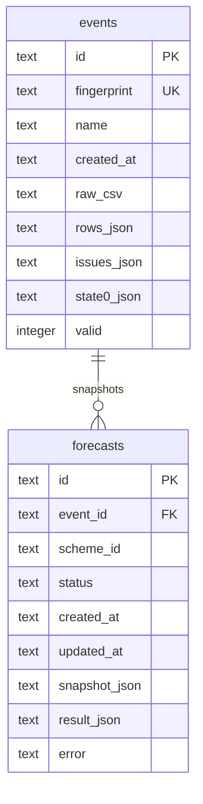
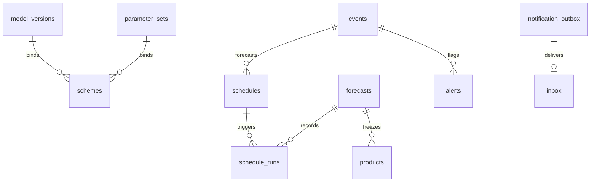

# 数据库结构与事务边界

SQLite位于DATABASE_PATH（Compose为/var/qinghe/system.db），当前schema_version=2。基础事件和预报表原样保留，migrations.py事务增加阶段3–4表；不删库重建。

events.fingerprint由原CSV、初态和质控配置共同生成；重复导入返回已有记录。ERROR仍入库并valid=0，不自动修复，任务不可引用。WARNING可计算。状态和结果在事务中更新，查询结果与任务快照对应。

领取任务使用BEGIN IMMEDIATE及状态条件更新，适配SQLite单机并发；不持有数据库锁等待HTTP。租约超时任务标记FAILED。事务提交前发生异常则回滚；每次连接都开启foreign_keys并关闭连接，禁止跨线程共享连接。

依赖方向：api→services→repository；worker→services；services经model_client访问模型HTTP；model_api→engine。数据库不依赖HTTP或模型业务。

## schema2新增实体

| 表 | 关联及目的 |
|---|---|
| model_versions | 模型源码SHA主键、名称、镜像引用、登记时间 |
| parameter_sets | 不可变参数JSON及摘要；UPDATE/DELETE触发器拒绝 |
| schemes | 绑定parameter_id与model_version，deleted实现软归档 |
| system_state | 持久化active/previous/canary/percentage，不用进程全局缓存 |
| products | 成功forecast关联、不可变内容和摘要、复核/签发/发布角色和时刻 |
| schedules | event_id、可空固定scheme_id、间隔、开关、下次UTC时刻、上次错误 |
| schedule_runs | 计划ID与scheduled_for唯一，关联本次forecast或失败原因 |
| qc_status | event_id唯一，最近重扫结果、规则摘要与时间 |
| qc_scans | 每次扫描数量、异常事件数量与时间 |
| alerts | event_id和问题签名联合唯一，保存问题及首次确认身份 |
| notification_outbox | 业务幂等键唯一，PENDING/DELIVERED/FAILED、次数及退避时间 |
| inbox | outbox_id唯一，真实站内收件记录，与投递状态同事务 |
| audit_log | 追加操作、身份、对象和详情，UPDATE/DELETE触发器拒绝 |
| runtime_status | worker/scheduler最近心跳与周期错误 |

forecasts的snapshot_json/event_id/scheme_id由触发器禁止UPDATE，产品content_json/摘要/标题/关联任务同样禁止修改。方案切换、产品状态迁移、调度提交、通知投递均使用BEGIN IMMEDIATE短事务，并在同一事务追加audit。创建任务不在事务中调用HTTP。

通知使用保存点处理单次本地投递异常，回滚该次插入后记录失败次数与下次尝试时刻。outbox_id与dedup_key的唯一约束避免重复业务事件或重复收件。SQLite整体不可写时无法记录失败计数，只能日志告警并在恢复后重试。
