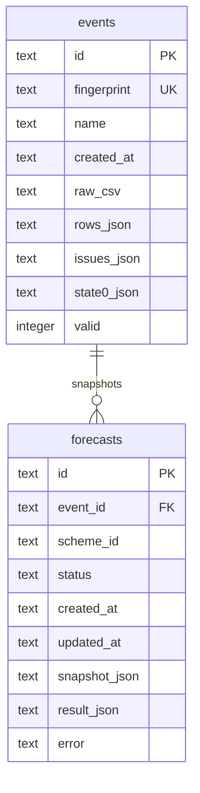

# 数据库结构与事务边界

SQLite位于DATABASE_PATH（Compose为/var/qinghe/system.db），schema_version=1。

events.fingerprint由原CSV、初态和质控配置共同生成；重复导入返回已有记录。ERROR仍入库并valid=0，不自动修复，任务不可引用。WARNING可计算。状态和结果在事务中更新，查询结果与任务快照对应。

领取任务使用BEGIN IMMEDIATE及状态条件更新，适配SQLite单机并发；不持有数据库锁等待HTTP。租约超时任务标记FAILED。事务提交前发生异常则回滚；每次连接都开启foreign_keys并关闭连接，禁止跨线程共享连接。

依赖方向：api→services→repository；worker→services；services经model_client访问模型HTTP；model_api→engine。数据库不依赖HTTP或模型业务。
